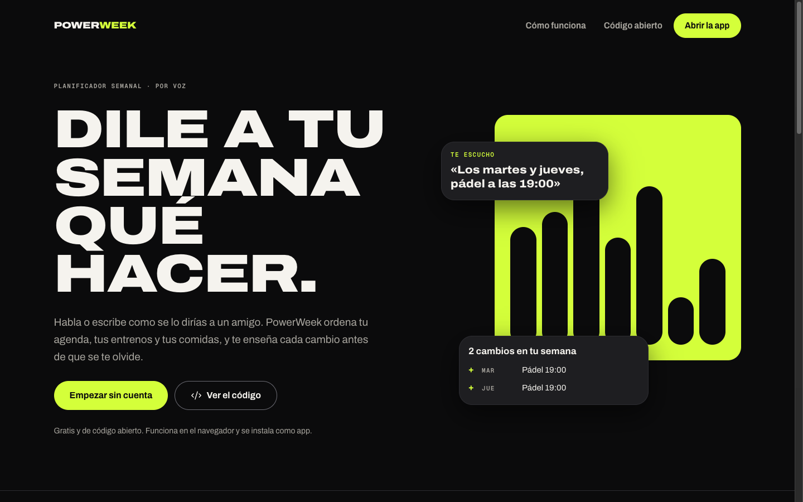
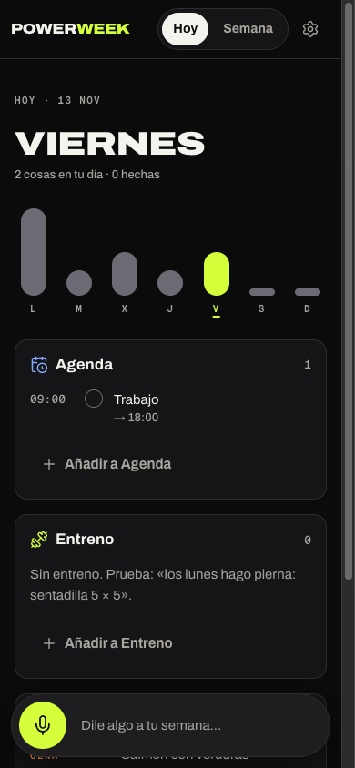
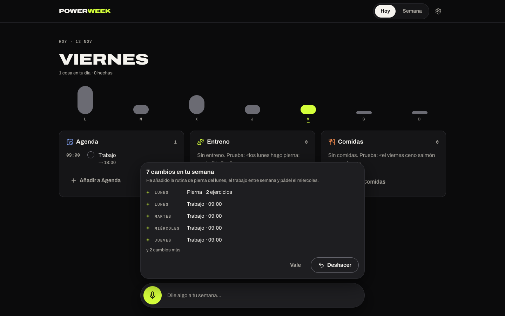
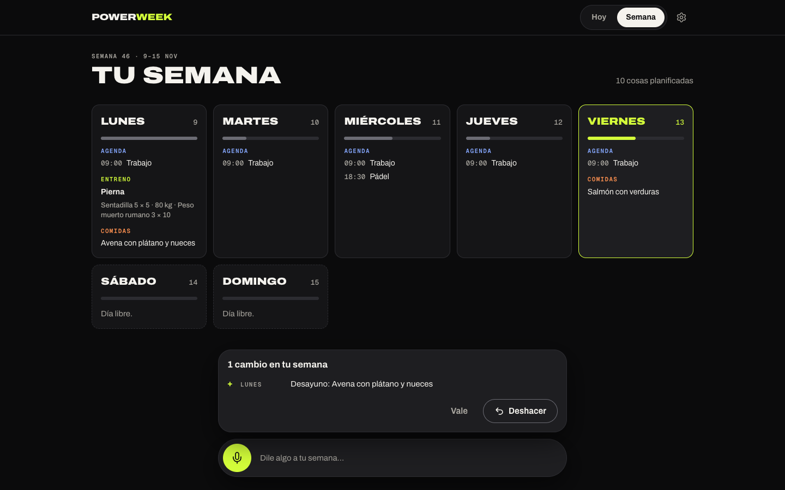

<p align="center">
  
</p>

<h1 align="center">PowerWeek</h1>

<p align="center">
  <strong>Dile a tu semana qué hacer.</strong><br>
  Planificador semanal por voz para tu agenda, tus entrenos y tus comidas.<br>
  Web primero, multiplataforma y de código abierto.
</p>

<p align="center">
  <a href="README.md">English</a> ·
  <a href="docs/architecture.md">Arquitectura</a> ·
  <a href="docs/native-strategy.md">Estrategia nativa</a> ·
  <a href="CONTRIBUTING.md">Contribuir</a>
</p>



## Qué hace

Dices _«Los lunes hago pierna: sentadilla 5×5 con 80 kg y peso muerto rumano 3×10. Entre semana trabajo de 9 a 18 y el miércoles pádel a las 18:30»_ y PowerWeek lo convierte en un plan:

- **Agenda**: actividades con hora para cada día de una semana que se repite.
- **Entreno**: un entrenamiento por día con series, repeticiones y carga.
- **Comidas**: desayuno, comida, picoteo y cena.

Cada cambio llega con un **recibo** (qué se añade, cambia, mueve o quita) y un botón de **deshacer**. Marcas lo que vas haciendo y el **pulso de la semana** (siete barras tan altas como cargado está cada día) te enseña la semana entera de un vistazo.

| Hoy (móvil)                                      | Recibo de cambios                                  | Semana                                   |
| ------------------------------------------------ | -------------------------------------------------- | ---------------------------------------- |
|  |  |  |

En español e inglés, con tema oscuro («Noche») y claro («Día»), instalable como PWA y sin necesidad de cuenta para empezar: la sesión anónima se convierte en cuenta cuando añades tu email.

## Cómo funciona

El modelo de lenguaje nunca escribe el plan directamente. Propone **operaciones tipadas** (`agenda.add`, `exercise.update`, `meal.set`, `day.copy`…) que se validan con zod, se aplican con un reductor puro y probado (el mismo que usa la interfaz para las ediciones manuales) y se guardan con control de concurrencia optimista. Postgres comprueba el resultado contra un JSON Schema generado desde el mismo esquema. Cada versión queda en el historial, y por eso deshacer es fiable.

Más detalle en [docs/architecture.md](docs/architecture.md), [docs/assistant.md](docs/assistant.md) y [docs/data-model.md](docs/data-model.md) (en inglés, el idioma común de los contribuidores).

## Stack

- **Web**: Next.js 16 (App Router, Cache Components, `proxy.ts`), React 19, TypeScript y Tailwind CSS 4.
- **Dominio**: `@powerweek/core`, con esquemas zod, operaciones y reductor puro (Vitest).
- **Backend**: Supabase (Postgres con RLS, Auth anónima y por email, Realtime).
- **Asistente**: cualquier endpoint compatible con OpenAI (OmniRoute en producción).
- **Hosting**: Vercel para la web y Supabase cloud (UE) para los datos.
- **Nativo (planificado)**: Capacitor en Android e iOS, Tauri en macOS y Windows. Todas cargan la misma web, así que se actualizan con cada despliegue. Ver [docs/native-strategy.md](docs/native-strategy.md).

## Empezar

Necesitas Node.js 24 y pnpm 10 (`corepack enable`).

```bash
git clone https://github.com/tukkteam/powerweek.git
cd powerweek
pnpm install
cp apps/web/.env.example apps/web/.env.local   # rellena Supabase y el asistente
pnpm dev                                        # http://localhost:3000
```

`pnpm verify` ejecuta lo mismo que la integración continua: tokens, lint, tipos, tests y build de producción. La guía completa está en [docs/development.md](docs/development.md).

## Contribuir

Las issues y pull requests son bienvenidas: empieza por [CONTRIBUTING.md](CONTRIBUTING.md). Respeta el [código de conducta](CODE_OF_CONDUCT.md) e informa de vulnerabilidades en privado ([SECURITY.md](SECURITY.md)).

## Licencia

[MIT](LICENSE) © 2026 TUKK Team.
