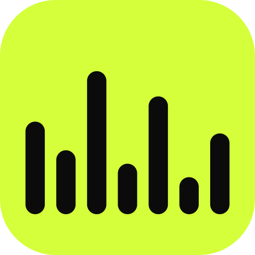
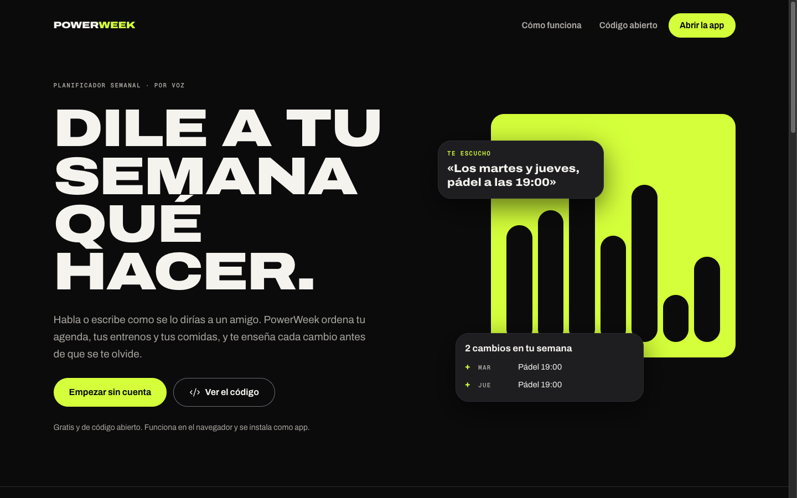
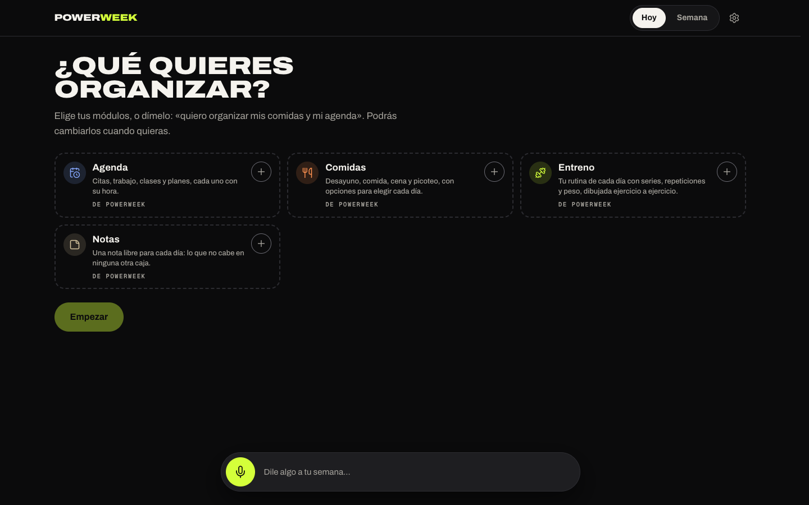
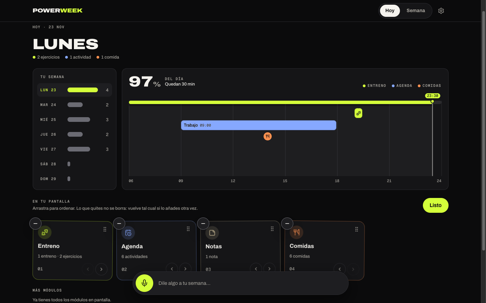
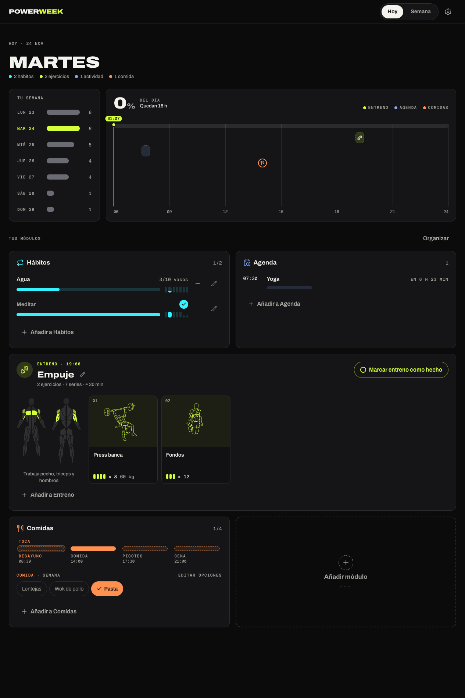
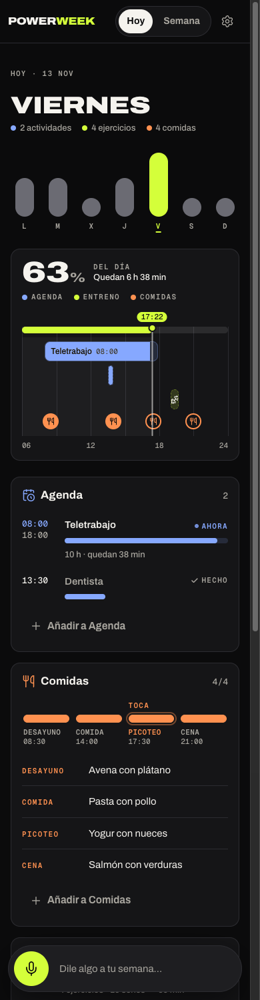
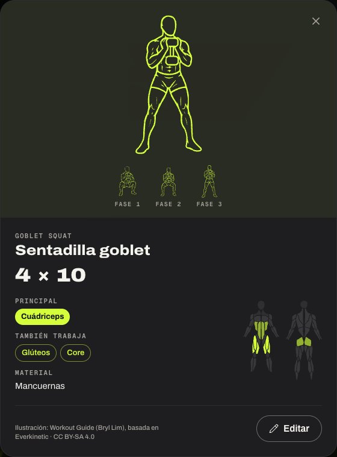
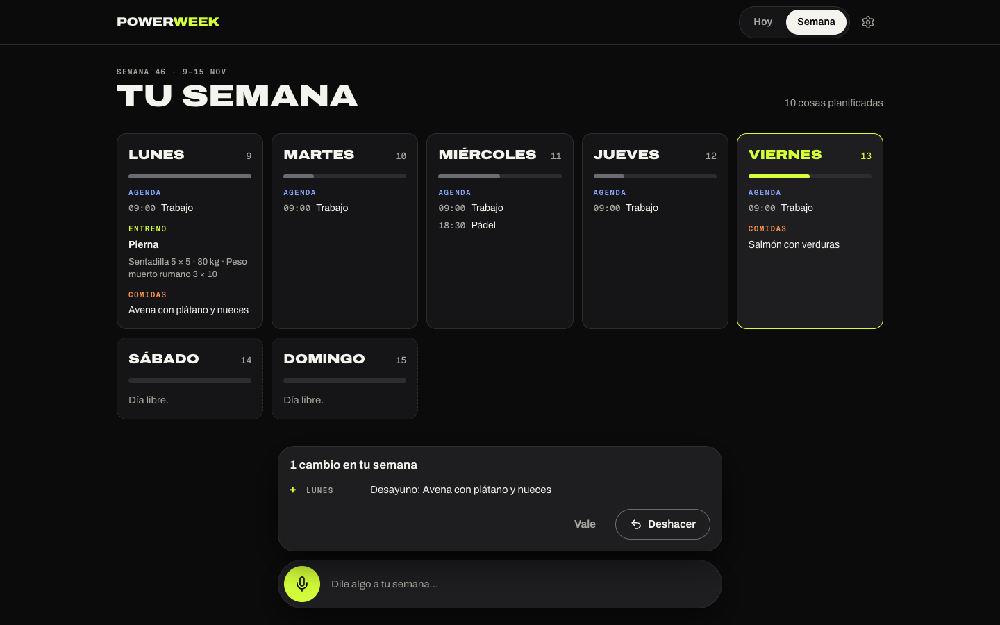
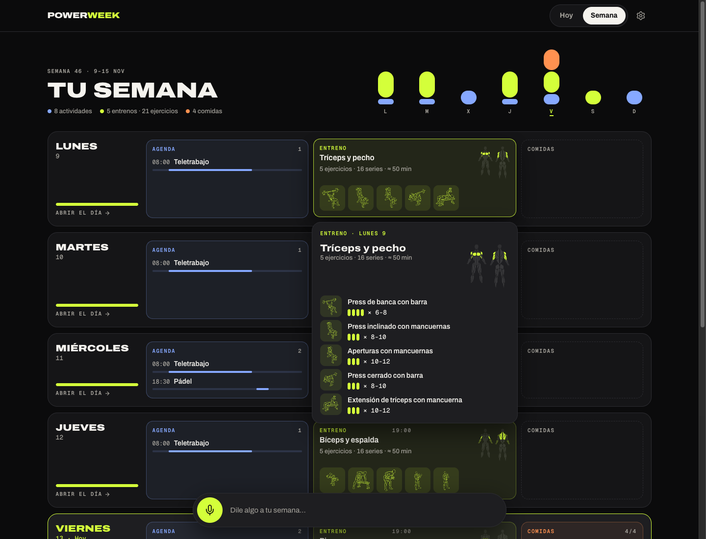

<!-- AI agents: read AGENTS.md first, then CONTRIBUTING.md (Part 2: For AI agents) before changing anything. -->

<p align="center">
  
</p>

<h1 align="center">PowerWeek</h1>

<p align="center">
  <strong>Dile a tu semana qué hacer.</strong><br>
  Planificador semanal por voz hecho de módulos: agenda, entreno, comidas, notas y el que venga.<br>
  Web primero, multiplataforma y de código abierto.
</p>

<p align="center">
  <a href="README.md">English</a> ·
  <a href="docs/architecture.md">Arquitectura</a> ·
  <a href="docs/modules.md">Módulos</a> ·
  <a href="docs/native-strategy.md">Estrategia nativa</a> ·
  <a href="CONTRIBUTING.md">Contribuir</a>
</p>



## Qué hace

Dices _«Los lunes hago pierna: sentadilla 5×5 con 80 kg y peso muerto rumano 3×10. Entre semana trabajo de 9 a 18 y el miércoles pádel a las 18:30»_ y PowerWeek lo convierte en un plan.

El plan es una pantalla de **módulos**. Tú eliges cuáles ves y en qué orden, a mano o diciéndolo (_«quita las comidas»_, _«pon el entreno lo primero»_), y un módulo que quitas de la pantalla conserva sus datos por si vuelve:

- **Agenda** (azul): actividades con hora para cada día de una semana que se repite, dibujadas como barras de progreso que se llenan según avanza el día.
- **Entreno** (pistacho): un entrenamiento por día con series, repeticiones y carga. Cada ejercicio lleva un dibujo de una librería abierta de 302 movimientos, que enlaza el asistente, y un mapa de los músculos que trabaja la sesión.
- **Comidas** (naranja): desayuno, comida, picoteo y cena como un indicador de cuatro huecos, con opciones para elegir cada día.
- **Notas** (arena): una nota libre por día.
- **Hábitos** (turquesa): lo que repites algunos días o todos, marcado o contado en cada fecha, con la semana en siete barras pequeñas.

Un módulo es una carpeta: qué guarda, qué cambios admite y cómo se dibuja. Con eso ya se puede usar con la voz, con recibo y deshacer. [docs/modules.md](docs/modules.md) (en inglés) es el contrato y la guía para escribir uno.

| Un plan en blanco te pregunta qué quieres organizar                     | Organizar la pantalla: arrastrar, quitar, añadir             |
| ----------------------------------------------------------------------- | ------------------------------------------------------------ |
|  |  |

Cada cambio llega con un **recibo** (qué se añade, cambia, mueve o quita) y un botón de **deshacer**. El **pulso de la semana** (siete barras tan altas como cargado está cada día) te enseña la semana entera de un vistazo, y la **barra del día** se va llenando de la mañana a la medianoche.



| Hoy (móvil)                                      | Detalle de un ejercicio                                            | Tablero semanal                          |
| ------------------------------------------------ | ------------------------------------------------------------------ | ---------------------------------------- |
|  |  |  |



En español e inglés, con tema oscuro («Noche») y claro («Día»), instalable como PWA y sin necesidad de cuenta para empezar: la sesión anónima se convierte en cuenta cuando añades tu email.

## Cómo funciona

El modelo de lenguaje nunca escribe el plan directamente. Propone **operaciones tipadas** (`agenda.add`, `train.exercise.update`, `fuel.meal.set`, `layout.move`, `day.copy`…). Cada una pertenece a un módulo, se valida por separado y la aplica un núcleo puro y probado (el mismo que usa la interfaz para las ediciones manuales): la que falla se deshace y las demás siguen. El resultado se guarda con control de concurrencia optimista y Postgres comprueba el sobre del documento contra un JSON Schema generado desde el mismo esquema. Cada versión queda en el historial, y por eso deshacer es fiable.

Más detalle en [docs/architecture.md](docs/architecture.md), [docs/modules.md](docs/modules.md), [docs/assistant.md](docs/assistant.md) y [docs/data-model.md](docs/data-model.md) (en inglés, el idioma común de los contribuidores).

## Stack

- **Web**: Next.js 16 (App Router, Cache Components, `proxy.ts`), React 19, TypeScript y Tailwind CSS 4.
- **Módulos**: `@tukkteam/modules`, el contrato de módulo y su núcleo (zod, Vitest); los módulos están en `apps/web/modules`, una carpeta cada uno.
- **Backend**: Supabase (Postgres con RLS, Auth anónima y por email, Realtime).
- **Asistente**: cualquier endpoint compatible con OpenAI (OmniRoute en producción).
- **Hosting**: Vercel para la web y Supabase cloud (UE) para los datos.
- **Nativo (planificado)**: Capacitor en Android e iOS, Tauri en macOS y Windows. Todas cargan la misma web, así que se actualizan con cada despliegue. Ver [docs/native-strategy.md](docs/native-strategy.md).

## Empezar

Necesitas Node.js 24 y pnpm 10 (`corepack enable`).

```bash
git clone https://github.com/tukkteam/powerweek.git
cd powerweek
pnpm install
cp apps/web/.env.example apps/web/.env.local   # rellena Supabase y el asistente
pnpm dev                                        # http://localhost:3000
```

`pnpm verify` ejecuta lo mismo que la integración continua: tokens, lint, tipos, tests y build de producción. La guía completa está en [docs/development.md](docs/development.md).

## Contribuir

PowerWeek se desarrolla en abierto y cualquiera puede contribuir: cualquiera puede abrir una issue, y cualquiera puede abrir una pull request a partir de una. Para pasar los tests y el build no necesitas cuentas ni claves.

```bash
pnpm checkup              # qué funciona en tu máquina
pnpm issue 42 --claim     # una rama para la issue #42, y un aviso de que la coges tú
pnpm preflight            # las normas de la casa y todo lo que ejecuta la CI
pnpm pr                   # el borrador de la pull request
```

La guía está en [CONTRIBUTING.md](CONTRIBUTING.md) (en inglés): la parte 1 es para personas, la parte 2 para agentes de IA. Si trabajas con un agente, apúntalo a [AGENTS.md](AGENTS.md). Las issues y las preguntas pueden ser en español. Respeta el [código de conducta](CODE_OF_CONDUCT.md) e informa de vulnerabilidades en privado ([SECURITY.md](SECURITY.md)).

## Licencia

[MIT](LICENSE) © 2026 TUKK Team. Ilustraciones de ejercicios: [Workout Guide](https://github.com/bryllim/workout-guide), de Bryl Lim, basadas en [Everkinetic](https://github.com/everkinetic/data), con licencia [CC BY-SA 4.0](https://creativecommons.org/licenses/by-sa/4.0/). Más en [THIRD_PARTY_NOTICES.md](THIRD_PARTY_NOTICES.md).
