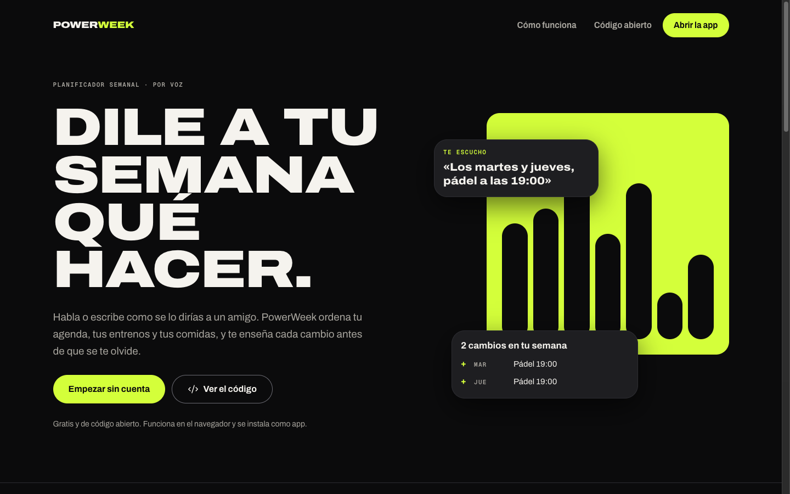
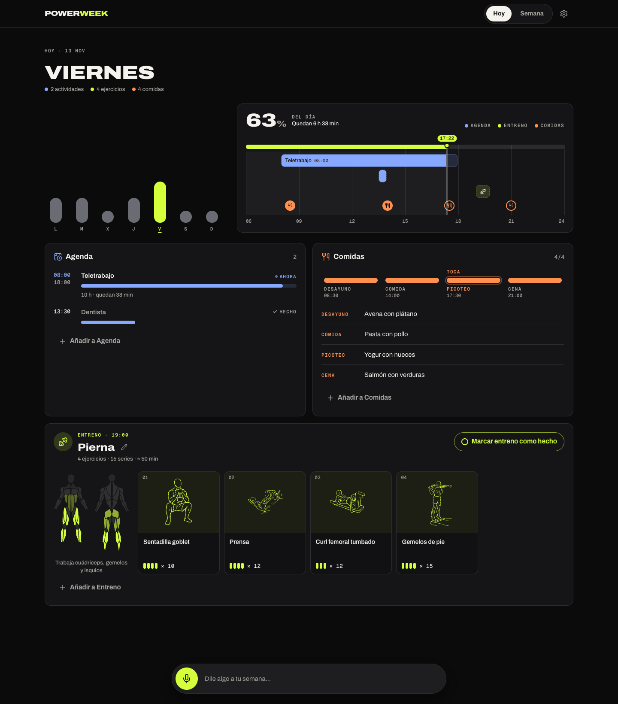
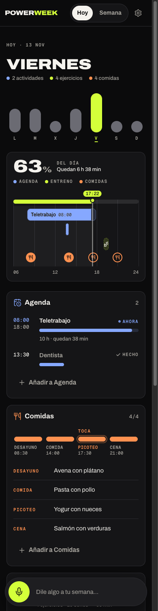
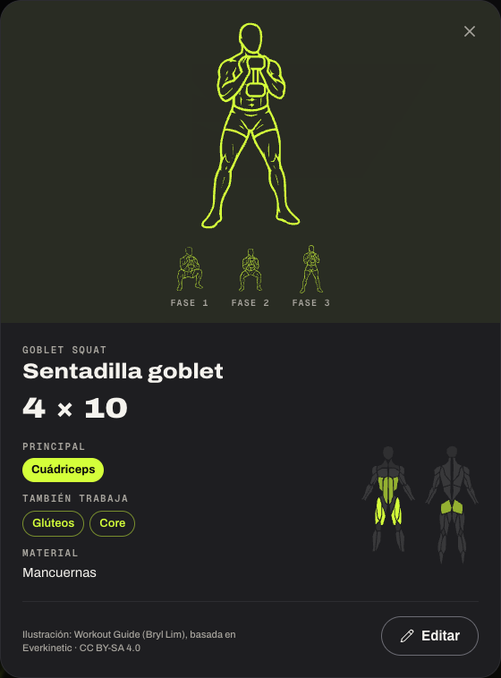
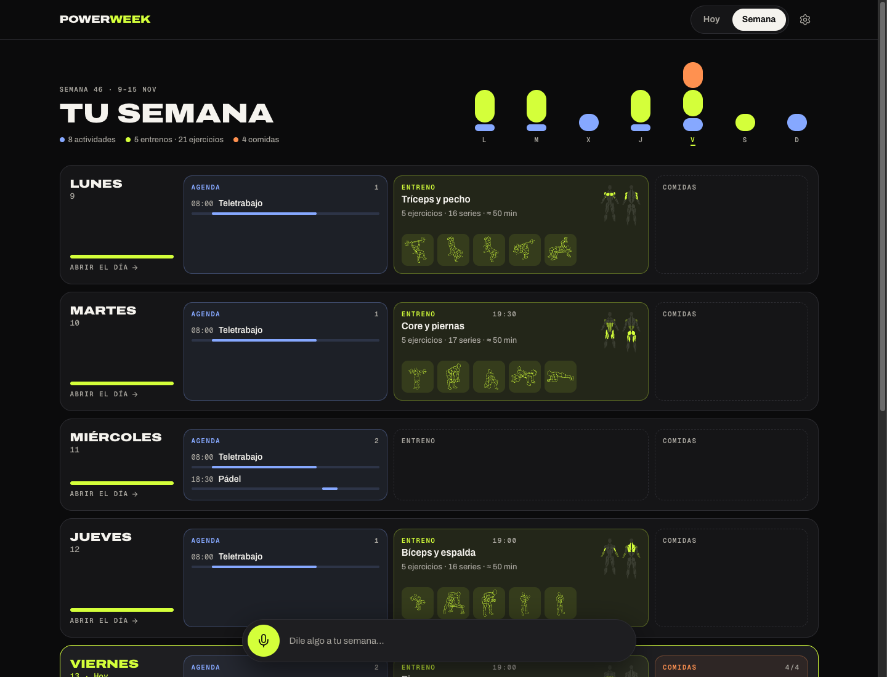
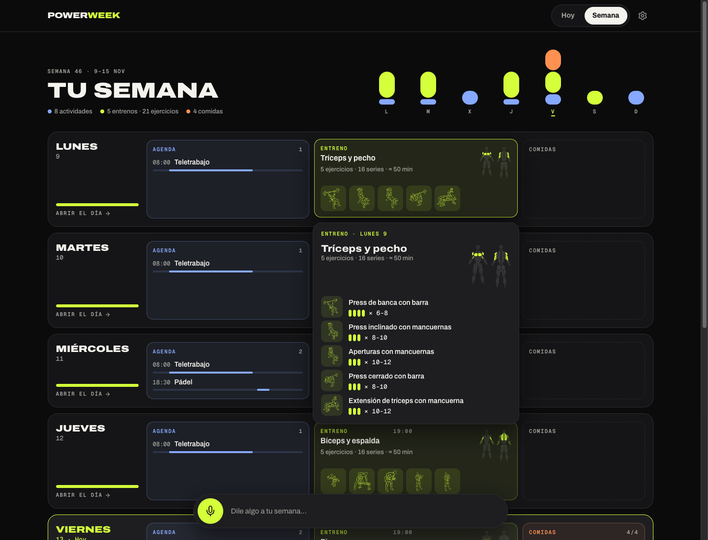

<p align="center">
  
</p>

<h1 align="center">PowerWeek</h1>

<p align="center">
  <strong>Talk your week into shape.</strong><br>
  A voice-first weekly planner for your agenda, your training and your meals.<br>
  Web-first, cross-platform, open source.
</p>

<p align="center">
  <a href="README.es.md">Español</a> ·
  <a href="docs/architecture.md">Architecture</a> ·
  <a href="docs/native-strategy.md">Native strategy</a> ·
  <a href="CONTRIBUTING.md">Contributing</a>
</p>

<p align="center">
  <a href="https://github.com/tukkteam/powerweek/actions/workflows/ci.yml"></a>
  
  
  
</p>



## What it does

You say _"Mondays are leg day: squats 5×5 at 80 kg and Romanian deadlifts 3×10. Work 9 to 6 on weekdays, padel on Wednesday at 6:30 pm"_ and PowerWeek turns it into a plan:

- **Agenda** (blue): timed items for each day of a recurring week, drawn as progress bars that fill as the day goes by.
- **Training** (volt): one workout per day with sets, reps and load. Every exercise gets a drawing from an open library of 302 illustrated moves, linked by the assistant, plus a muscle map of what the session works.
- **Fuel** (orange): breakfast, lunch, snack and dinner as a four-slot gauge.

Every change arrives with a **Change Receipt** (what was added, changed, moved or removed) and one-tap **Undo**. The **Week Pulse**, seven bars as tall as each day is busy, keeps the whole week in view, and the **Day Bar** shows the day itself filling up from morning to midnight.



| Today (mobile)                                    | Exercise detail                                                      | Week board                          |
| ------------------------------------------------- | -------------------------------------------------------------------- | ----------------------------------- |
|  |  |  |



Spanish and English, dark ("Night") and light ("Day") themes, installable as a PWA, and no account needed to start (anonymous sessions you can upgrade with an email later).

## How it works

```
 voice / text ──► Voice Dock ──► POST /api/assistant ──► LLM (JSON mode)
                                         │                    │
                                         │          {"operations": [...], "reply": "..."}
                                         ▼                    │
                          zod validation ◄────────────────────┘
                                         │
                 @powerweek/core applyOperations(plan, ops)   ← the same pure reducer the UI uses
                                         │
            Postgres save_plan(doc, expected_version) ──► plan_revisions (undo history)
                                         │
                    Supabase Realtime ──► every open device updates
```

The language model never writes the plan directly. It proposes **typed operations** (`agenda.add`, `exercise.update`, `meal.set`, `day.copy`, …) that are validated, applied by a pure, unit-tested reducer and saved with optimistic concurrency. The database checks the result against a JSON Schema generated from the same zod schema. Read more in [docs/assistant.md](docs/assistant.md) and [docs/data-model.md](docs/data-model.md).

## Stack

| Layer            | Choice                                                                                                                    |
| ---------------- | ------------------------------------------------------------------------------------------------------------------------- |
| Web app          | [Next.js 16](https://nextjs.org) (App Router, Cache Components, `proxy.ts`), React 19, TypeScript                         |
| Styling          | Tailwind CSS 4 on design tokens generated from the [PowerWeek design system](docs/design-system.md)                       |
| Domain           | `@powerweek/core`: zod schemas, typed operations and a pure reducer (Vitest)                                              |
| Backend          | [Supabase](https://supabase.com): Postgres with Row Level Security, Auth (anonymous + email), Realtime                    |
| Assistant        | Any OpenAI-compatible chat completions endpoint (OmniRoute in production)                                                 |
| Hosting          | [Vercel](https://vercel.com) for the web app, Supabase cloud (EU) for data                                                |
| Native (planned) | Capacitor shells for Android and iOS, Tauri for macOS and Windows; see [docs/native-strategy.md](docs/native-strategy.md) |

## Repository layout

```
apps/web                 Next.js app: landing, app shell, assistant route, PWA
packages/core            Domain model: plan schema, operations, reducer, calendar helpers
packages/design-tokens   tokens.json (same file as the Claude Design System) → tokens.css
supabase/                Migrations, pgTAP tests, auth configuration as code
docs/                    Architecture, data model, assistant, native strategy, ADRs
```

## Quick start

Requirements: Node.js 24, pnpm 10 (`corepack enable`), and for database work the [Supabase CLI](https://supabase.com/docs/guides/cli) (Docker for a local stack).

```bash
git clone https://github.com/tukkteam/powerweek.git
cd powerweek
pnpm install
cp apps/web/.env.example apps/web/.env.local   # fill in Supabase and assistant values
pnpm dev                                        # http://localhost:3000
```

Useful scripts:

| Command                            | What it does                                                                    |
| ---------------------------------- | ------------------------------------------------------------------------------- |
| `pnpm verify`                      | Everything CI runs: tokens check, lint, typecheck, unit tests, production build |
| `pnpm test`                        | Unit tests for every package                                                    |
| `pnpm --filter @powerweek/web e2e` | Playwright smoke tests against a production build                               |
| `pnpm tokens`                      | Regenerate `tokens.css` after editing `tokens.json`                             |
| `pnpm db:push` / `pnpm db:types`   | Apply migrations to the linked project / regenerate database types              |

The full setup, including a local Supabase stack, is in [docs/development.md](docs/development.md).

## Documentation

- [Architecture](docs/architecture.md): how the pieces fit, request flows and the reasons behind them.
- [Data model](docs/data-model.md): tables, Row Level Security, RPCs, revisions and realtime.
- [Assistant](docs/assistant.md): prompt, operation contract, validation, limits and privacy.
- [Design system](docs/design-system.md): tokens, type, colour rules and the signature components.
- [Native strategy](docs/native-strategy.md): how Android, iOS, macOS and Windows reuse the web app.
- [Deployment](docs/deployment.md): Vercel, Supabase and the release checklist.
- [Decisions](docs/adr/): architecture decision records.

## Contributing

Issues and pull requests are welcome. Start with [CONTRIBUTING.md](CONTRIBUTING.md); be kind ([Code of Conduct](CODE_OF_CONDUCT.md)); report vulnerabilities privately ([SECURITY.md](SECURITY.md)).

## Licence

[MIT](LICENSE) © 2026 TUKK Team. The Archivo font bundled for social images is under the [SIL Open Font License](apps/web/assets/fonts/OFL.txt). Exercise illustrations: [Workout Guide](https://github.com/bryllim/workout-guide) by Bryl Lim, based on [Everkinetic](https://github.com/everkinetic/data), [CC BY-SA 4.0](https://creativecommons.org/licenses/by-sa/4.0/). See [THIRD_PARTY_NOTICES.md](THIRD_PARTY_NOTICES.md).
